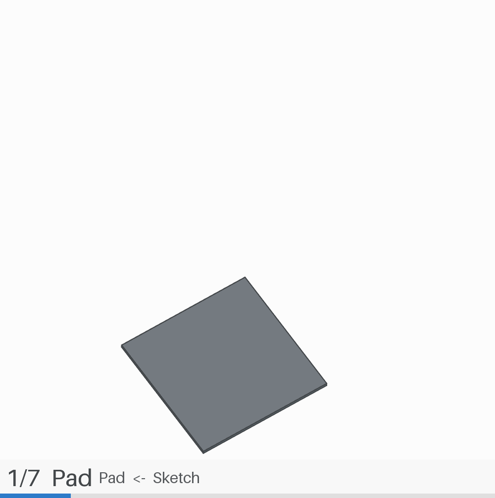

# Selection interface for LLM — build timeline for FreeCAD PartDesign



*Replaying `guide_percage26.FCStd`: 7 building steps, one frame each — the plate, then the
boss and its ribs, then the finished part. Generated by the addon itself, with the camera
angle preserved.*

**Build timeline of a PartDesign document.** The addon lists the real construction order of
every feature, shows them one at a time (datum planes and the driving sketch included)
without modifying your model, replays the build-up as an animated GIF that keeps your
viewing angle, and writes a ready-to-paste description of any single feature for an LLM.

*Never saves your document · never adds geometry · restores every view change · no network.*

**Search words** — build order, construction order, build timeline, timelapse,
feature by feature, step by step, animation, GIF, datum plane, driving sketch, LLM.

Repository: <https://github.com/Tithanium/Selection_interface_for_LLM> — version 2.1.1.
This repository **is** a FreeCAD addon (`package.xml` at the root);
[ADDON_ROADMAP.md](ADDON_ROADMAP.md) records the state of the addon work, and
[PUBLISH.md](PUBLISH.md) is the kit that makes it findable (naming, keywords,
paste-ready announcements).

```
Selection_interface_for_LLM/                  <- the addon. Copy or clone it into <user>/Mod/
├── package.xml                               addon manifest (name, version, classname, licenses)
├── pyproject.toml                            dev tooling only
├── LICENSE-Code  LICENSE-Assets              LGPL-2.1-or-later / CC-BY-SA-4.0
├── README.md  CHANGELOG.md  task.md  ADDON_ROADMAP.md
├── freecad/
│   └── SelectionInterfaceForLLM/             namespaced Python package (no sys.path tricks)
│       ├── __init__.py                       headless entry point, no Qt
│       ├── init_gui.py                       registers icons, commands and the workbench
│       ├── workbench.py                      "Selection interface" workbench + toolbar
│       ├── commands.py                       Building steps panel / GIF of the whole build
│       ├── interface.py                      ordering engine, panel, GIF export (the logic)
│       ├── version.py                        the single version number
│       └── resources/                        icons/Logo.svg, docs/Overview.md
├── tests/
│   ├── report_order.py                       headless order check  (freecadcmd)
│   └── check_timelapse.py                    output-folder verifier (plain python)
└── dev/
    └── Selection_interface_for_LLM.FCMacro   developer shim, NOT part of the addon
```

## Install

**As an addon (recommended).** Copy or clone this repository into the `Mod` folder
of your FreeCAD user data, so that `package.xml` ends up at
`<user>/Mod/Selection_interface_for_LLM/package.xml`, then restart FreeCAD. The
workbench **Selection interface** appears in the workbench selector, with the
toolbar commands *Building steps panel* and *GIF of the whole build*. On Windows
`<user>` is `%APPDATA%\FreeCAD\v1-1`; `FreeCAD.getUserAppDataDir()` gives the
right folder on every system. After the restart, the Report view lists the addon in
its *Mod summary* table with mode Ext (that is FreeCAD confirming it imported
reecad.SelectionInterfaceForLLM.init_gui); if the workbench does not appear, that
table says why.

**As a macro (development).** `dev/Selection_interface_for_LLM.FCMacro` can be put
in the macro folder and run from `Macro > Macros...`; it finds the package, loads
it and opens the panel. It exists only to work on a checkout — the addon never
manipulates `sys.path`, the shim does.

## Use

1. Activate the **Selection interface** workbench and click **Building steps
   panel** (or run the macro, in development).
2. A dock named **Selection interface for LLM - building steps** appears on the right. At the top, the
   **display** list chooses how everything is drawn: `solid + edges`, `solid`,
   `edges only`, `transparent`, `points`. Just below, the **show also** boxes choose
   *what* is drawn (all ticked by default):

   | box | what it adds |
   |---|---|
   | `datum objects` | the datum planes / lines / points of the steps already built stay on screen. Unticked they stay hidden from one level to the next, and only the datum of the level being looked at is shown, so a datum step still displays what it must |
   | `profile sketch` | the sketch the selected feature is built from, highlighted orange |
   | `other bodies` | the parts built by the other bodies at this level. Unticked, only the body of the selected step is drawn (for a mirror or a boolean, the body it copies) |
   | `base / fused results` | **unticked by default.** A `PartDesign::FeatureBase` / `Part::MultiFuse` / `Part::Fuse` does not build a new shape, it repeats the shape of the pieces it is made from (measured: the BaseFeature of `02_seringue_cardanV3` step 60, its MultiFuse and the two halves it fuses are the same 99563.843 mm3 solid, common volume 100.00 %, same placement). Unticked, such a step is drawn at its own step only and the objects it consumes stop being drawn on their own, so the same surface is never painted twice. Ticked, it stays on screen from its step on, exactly like the tree of the document — the coincident surfaces then shimmer like a mesh |

   Just under them, **`select in the model tree`** (ticked by default) makes
   every step click expand the model tree down to what you are looking at and
   select it, so the feature — or the sketch that drives it — can be edited
   straight away (see *Edit the feature right away* below). Untick it to browse
   without touching your selection.

   Below them, the recovered computation order is listed: `#`, feature label,
   `type <- what it consumes`. Datum planes, lines, points and coordinate systems
   are steps like any other feature.

3. `step >` / `< step`, the spin box, or clicking a row moves the development
   level and the 3D view shows exactly what that level holds: the last built
   feature of every body, the datums reached so far, and the **sketch that gives
   birth to the selected feature** (highlighted orange, with its body shown
   see-through so a profile inside the material is visible). `reset` = nothing
   built, `final` = the finished part. The **model tree follows too**: the branch
   opens down to the step's object and that object is selected — the sketch when
   the profile is shown — so it can be edited immediately (*Edit the feature right
   away* below; the `select in the model tree` box switches this off). Nothing in
   the model is changed: only view properties (visibility, display mode,
   transparency, sketch colour) are set.
4. **create GIF (all steps)** frames the final part from the current viewing
   angle, sweeps every step, writes
   `Downloads\FreeCAD_timelapse\<document>_<stamp>\` with
   `frames\NNN_<label>.png`, `timelapse_<doc>.gif`, `manifest.json`, `steps.txt`.
5. **open GIF** opens the run folder that holds it (file selected in Explorer)
   and plays the GIF right away in a small window inside FreeCAD
   (`7 frames | 1000x1006 px | 106 kB` + the full path), with `open folder` and
   `open with Windows viewer` buttons there as well. With no run in this session
   it picks the newest GIF under `Downloads\FreeCAD_timelapse\`, preferring one
   made from the active document.
6. `restore original` (or closing the panel) puts back tips, visibility, display
   mode, transparency, sketch colours **and the selection** the document had
   before the macro touched it. The document is **never saved**.
7. Under the buttons, type the change you want in the small text box (e.g.
   `set holes diameter to 5mm`), select the step in the list and click
   **copy to clipboard description for LLM**: a self-contained request is copied,
   ready to paste into an LLM session (see below).

## Edit the feature right away: the tree follows the step

Clicking a step does not only change the 3D view: the model tree expands down to
that object and selects it, so the next double-click lands on the feature you are
looking at instead of being a hunt through the tree.

- **what gets selected** is what the panel is showing: the *sketch* that drives
  the selected feature (that is where the dimensions live — on `guide_percage26`
  step 3 *Pocket*, selecting the pocket would be useless, its `Sketch002` is what
  carries the hole diameter), otherwise the feature itself, otherwise the datum
  plane when the step is one;
- the branch opens, the row is scrolled into view and the status line says what
  was picked:
  `selected in the tree: trou   (the sketch of this step)   (3 branch(es) opened)`;
- **`select in the model tree`** (ticked by default) turns the whole thing off
  when you want to browse without disturbing your own selection;
- `restore original` and closing the panel give your **previous selection back**,
  like every other thing the panel changed;
- **create GIF** captures with *nothing* selected: a selected object is drawn
  highlighted and that highlight would be burned into every frame (measured on
  `guide_percage26`: selecting one object changes 18 436 pixels of the capture).
  The selection is put back when the run ends.

Two facts about FreeCAD 1.1.4 worth knowing here, both measured: the model tree
is a `Gui::TreeWidget` whose items expose **only their text** —
`item.data(0, Qt.UserRole)` is `None` for every document object — so the object is
found by matching its Label, then its internal Name, and two objects sharing a
label give the first match. And FreeCAD **deletes and recreates every item**
whenever the document changes, so a `QTreeWidgetItem` reference dies between two
calls (`Internal C++ object ... already deleted`): the find-then-use sequence is
retried after letting the event loop run, and the item is fetched with a single
`findItems()` call rather than a Python walk.

## The profile of the selected feature, as a thick orange line

The sketch that gives birth to the selected feature is highlighted in orange.
Drawing it as a line is not enough: the OpenGL driver clamps the width of a drawn
line, so `LineWidth` stops having an effect. Measured on this machine, orange
pixels of the profile in a 900x640 capture of `_02_seringue_cardanV3`:

| `LineWidth` | 1.0 | 3.0 | 6.0 | 10.0 |
|---|---|---|---|---|
| orange pixels | 709 | 850 | 1017 | 1219 |

and `PointSize` (with `DisplayMode = 'Points'`) changes nothing at all (686 at 2,
642 at 12). So the profile is rebuilt as a chain of small tubes placed in the
**Coin scene graph** of the 3D view instead of in the document:

* the tubes are sized from the camera zoom (`cam.height / viewport pixels`), so the
  line looks the same width (`PROFILE_LINE_PIXELS = 5.5`) at any zoom instead of
  being scaled with the part;
* the chain is wrapped in `SoAnnotation`, which is drawn after the model with the
  depth test off, so the profile is not swallowed by the material it is padded or
  revolved into;
* nothing is added to the document — removing the node restores the exact view, and
  the overlay is dropped by `restore_state()`, by 'restore original', by closing the
  dock and by any level change without a profile;
* GIF frames skip it (`see_through=False`), so the animation stays clean and does
  not flicker between a thin and a thick profile.

Measured effect on the piston revolution profile (`_02_piston_cardanV3` step 11, no
overlay vs overlay): 2566 -> 10809 orange pixels, and the line reads 7 px wide
where the sketch's own line is 4 px at that zoom (1-2 px at normal zoom).

## Two objects, one surface (z-fighting)

On `02_seringue_cardanV3`, step 59 fuses the two halves of the encastrement and step
60 inserts that fusion into the `Encastrement` body. Three objects therefore carry
the very same surfaces:

| object | type | volume |
|---|---|---|
| `E15_Trou_ecrou_carres2` + `Encastrement_moitie_miroir` | body feature + mirror | 49781.921 + 49781.921 mm3 |
| `Encastrement_brut` | `Part::MultiFuse` | 99563.843 mm3 |
| `BaseFeature` | `PartDesign::FeatureBase` | 99563.843 mm3 (`common volume` with the fusion: **100.00 %**, same placement) |

Drawn together they z-fight (the grey block shows internal seams and hatched
patches, like a mesh) and the opaque copy in front cancels the see-through of the
selected object. That is a display problem, not an ordering one, and it is what the
`base / fused results` box is for: unticked (default) the fusion takes the place of
the pieces it is made from — at step 59 the two halves go away, at 60 the fusion goes
away, from 61 on the body's own features carry the shape. One copy of each surface at
every frame, measured on the same frame: `60_dup_on` (coincident copies) mean
brightness 201.06 vs `60_dup_off` 209.81, 161807 pixels different.

The see-through now also applies to such a step (it used to be armed only when the
step had a profile sketch, so a `FeatureBase` stayed opaque): at step 60 the
encastrement becomes translucent (mean 209.81 -> 213.91, 143002 pixels change) and
its internal cavities and the parts inside it show.

## What "displaying a step" means exactly

A Body in its default `Tip` display mode always draws its tip, whatever is
visible, so it cannot show a datum plane alone; the panel therefore puts every
body in `DisplayModeBody = Through` and drives the visibility of each feature
individually. Measured on this build:

| what must appear | how it is obtained |
|---|---|
| the feature built at step k | its own `ViewObject.Visibility = True`, every other feature of that body `False` |
| a datum plane / line / point | its own visibility once its step is reached (a datum has no solid, and its `Shape.Volume` is meaningless: never used as a measurement) |
| the sketch behind the feature | shown alone, `LineWidth = 3`, `LineColor` orange, and the body's features set to `Transparency = 70` so a profile buried inside the material still shows |
| an `App::Part` / group container | kept visible: a hidden container hides all its children (a datum plane inside a hidden container renders nothing at all) |

The panel status names what is on screen, e.g.
`level 12/66: P01 Piston_and_M5 (Revolution)   |   20427.3 mm3   |   profile: P profil Piston_and_M5`
and `level 1/66: C Reference_encastrement (DatumPlane)   |   datum plane/line shown`.

All 66 levels of `02_piston_cardanV3` and all 68 of `02_seringue_cardanV3` were
checked this way (`tl_verify.check`): every datum appears exactly at its level and
disappears after, exactly the last built feature of each body is drawn, every body
stays in `Through` mode, and the selected feature's sketch is visible and
highlighted while no other sketch is (0 failures, 0.5 s and 2.7 s per document).

## Change one feature with an LLM (copy/paste bridge)

The request is feature-aware, so it works for every family of feature the tree can
hold:

| feature family | what the request says it is built from |
|---|---|
| Pad, Pocket, Revolution, Groove | `Profile` -> `Sketch002 (Sketcher::SketchObject)` |
| PolarPattern, LinearPattern, Mirrored, MultiTransform | `Originals` -> the feature(s) it duplicates |
| Chamfer, Fillet, Thickness, Draft | `Base` -> the base feature **plus the edges** it acts on |
| Boolean, `Part::Cut` / `Fuse` / `Common` | the features or the tool it combines |
| anything else | its `OutList` inputs |

plus its key parameters as real quantities (`Length=5.0 mm`, `Occurrences=4`, ...).
Every request also carries: the **folder, file name and full path** of the source with
an explicit *do not modify it, keep its SHA256*; the **name the new part is saved
under** (`<stem>_modified.FCStd`, or `-2`, `-3` ... if that name is taken); the
document, body and body tip; the feature **label and internal name** (what
`getObject()` takes, which is not the label); its solid volume at that step and at the
end; the whole computation order with `>>` on the selected step; your text verbatim;
and what the answer must contain (identify the carrier of the dimension, change the
copy only, recompute cleanly, report before -> after values and a screenshot).

Why the whole order travels with the request: the dimension to change is often not on
the step itself. In the reference test the selected step was `Pocket`, which profiles
`Sketch002` - but `Sketch002`'s radius is driven by external geometry from
`Sketch001` (label `trou`), which is where the Ø26.5 really lives.

### Verified end to end

The clipboard text was pasted into a fresh `pi` session (nothing shared with the
FreeCAD side) for `guide_percage26` step 3 with `set holes diameter to 5mm`:

- it found `Sketch001/trou` `Diameter 26.5 -> 5.0`, proved the Pocket profile was
  driven from it (`Equal` + projected edge) and rejected the naive reading;
- it wrote `guide_percage26_modified.FCStd` and left the source byte-identical
  (SHA256 `18a1228f...f29b7373` before and after);
- independent headless probe of both files: same 21 objects, same 21 faces, 1 solid,
  bbox 80x80x51 mm, `Sketch001` diameter `26.5 -> 5.0`, tip volume
  `15959.481 -> 9740.565 mm3`, and no other sketch dimension touched.

Two traps met while testing: build the request from the panel state, never from
`QApplication.clipboard().text()` - reading the Windows clipboard from the FreeCAD
process hung a 60 s RPC call; and normalise the path with `os.path.normpath`, because
`doc.FileName` mixes `/` and `\`.

## How the order is recovered

**A piece built by several features never appears from nowhere.** The order comes
from the model's own links (a Kahn topological sort over `OutList`, tie-break on
document order), then each body is checked against its `Tip -> BaseFeature` walk.
The subtle part is a step that consumes a whole **body**: `Part::Mirroring`,
`Part::MultiFuse`, a boolean, a `PartDesign::FeatureBase`. Those link the *Body
object*, which is not a step, so the sort learned nothing from the link and put
the step right after the body's first feature. The finished copy then appeared in
one go while its source was a single pad — measured on `02_seringue_cardanV3`,
`01_Corps_seringue copie symetrique` was step **4** while 14 of the 15 features of
the body it copies were still to come (steps 25..66).

The link is now **expanded to the body's construction** (every built feature
inside it, recursively for an `App::Part` / group), so the copy can only arrive
after the piece it duplicates is complete. On the same file the mirror moved to
step **57** and `timeline()` reports the expansion in its `notes`:

```
whole-body links expanded to their construction: Cardan_miroir <- 9 feature(s),
Corps_seringue_miroir <- 17 feature(s), Encastrement_brut <- 22 feature(s), ...
```

`02_piston_cardanV3`: 4 mirrors + 1 fuse moved, 66 steps before and after, 0
warnings; `02_seringue_cardanV3`: 4 moved, 68 steps before and after, 0 warnings.
A mirror is a single atomic feature, so its own copy still appears in one step —
what changed is that the origin is fully built by then.

1. every object that produces a shape (sketches, datums, origins, bodies and
   containers are excluded) is topologically sorted on its real links
   (`OutList` within that set), ties broken by document order;
2. each `PartDesign::Body`'s `Tip -> BaseFeature -> ...` chain — the actual
   computation order of PartDesign — is walked and compared with the sorted
   result; a mismatch is reported in the panel/Report view and the tip chain wins.

Verified on `guide_percage26.FCStd` (7 steps, two `PartDesign::Mirrored` features)
and `toscin_5_26.FCStd` (9 steps, one `PartDesign::PolarPattern`); both agree.

## What the camera does (and does not) change

Clicking **create GIF** never changes the viewing angle. The zoom (and the
centering, when needed) adapt so that the *complete* part fits the frame:

1. the camera is snapshotted — angle, zoom, centering, clipping planes — as plain
   tuples (`SbVec3f`/`SbRotation` from `field.getValue()` are live proxies of the
   Coin field: storing them makes "restore" a no-op, measured on 1.1.4);
2. the final level is applied and `fitAll()` runs once;
3. the saved orientation is re-applied and verified (`getViewDirection()` dot
   product), retried if it does not settle — `fitAll()` keeps the direction on
   this build, but the re-apply keeps the guarantee version independent;
4. the sweep then never re-fits: every frame shares the same angle, zoom and
   centering;
5. at the end the whole camera is restored (angle, zoom, centering, clipping).

Measured on `guide_percage26` with a deliberately twisted camera (30 deg off the
isometric direction, height 18 instead of ~124, panned by 9 mm):

| stage | angle vs the user's angle | zoom | centering |
|---|---|---|---|
| at the click | 0.00000000 deg | 18.00 | 0 |
| after `fitAll` + re-apply | 0.00000000 deg | 124.10 | 113.6 mm |
| every captured frame | 0.00000000 deg | 124.10 (constant) | 113.6 mm (constant) |
| after the run | 0.00000000 deg | 18.00 (restored) | 0 mm (restored) |

A rotation injected deliberately between `fitAll()` and the capture is undone by
the re-apply: the frames still equal the user's angle. Each run records this in
`manifest.json` → `camera` (`angle_offset_deg`, `angle_preserved`, `zoom_before`,
`zoom_capture`, `centering_mm`) and prints it in the panel:

```
camera: viewing angle kept (0.0000 deg), zoom 26.0 -> 124.101, centering moved 25.902 mm
```

## Checks that ship with it

```powershell
$fc = "$env:LOCALAPPDATA\Programs\FreeCAD 1.1\bin\freecadcmd.exe"
# 1. headless: does the recovered order match the tip chain? (read-only, exit 0/1)
& $fc report_order.py "C:\path\part.FCStd"

# 2. after a GIF run: re-derives every number from the PNGs (plain python + Pillow)
python check_timelapse.py "C:\Users\<you>\Downloads\FreeCAD_timelapse\<doc>_<stamp>"
```

`check_timelapse.py` exits 0 only when: one frame per recorded step in order, the
frame labels match the step labels, no frame is blank, all frames share one size,
the manifest's per-step change is reproduced from the images, and — for
integrity only — the GIF holds the same number of frames and each GIF frame
agrees with its PNG (mean difference < 6 %). It never judges the animation
visually: the frames are the evidence.

## Notes and traps handled

- `saveImage()` is verified with Pillow before a frame is accepted; a blank frame
  aborts the run instead of producing a blank GIF. A main-window grab cropped to
  the 3D subwindow is the fallback.
- `SbVec3f` / `SbRotation` returned by a Coin field's `getValue()` are **live
  proxies**: a stored "snapshot" follows every later camera move, so the camera
  must be copied into plain tuples (this bug silently disabled the pan restore).
- The dock is hidden while the frames are captured, the viewport is allowed to
  settle, then the camera is fitted on the complete part and the user's viewing
  angle is re-applied (`fitAll` replaces the camera node and resets the
  orientation) and frozen — `AnimationDuration` is set to 0 for the run.
- A step whose change is invisible from the current angle is still exported as a
  frame and reported in `manifest.json` → `flat_frames`; that is a property of the
  model/angle, not a missing frame.
- PIL and numpy are used from FreeCAD's own bundled Python (Pillow 12 present),
  so the GIF needs no external tool.
- **The tab in front decides what a capture shows**, and matching it by the first
  characters of the file name picked the wrong tab between `..._cardanV2` and
  `..._cardanV3`: the tab label is now compared exactly (tab titles carry a
  `: 1*` suffix that must be stripped) and the document is made active
  explicitly before any capture.
- A `Body` in `DisplayModeBody = 'Tip'` draws its tip no matter what, so datums and
  sketches cannot be displayed with it; the panel uses `'Through'` plus per-feature
  visibility. A `Body` also needs `Visibility = True` for its children to render at
  all, and a hidden `App::Part` hides every child of it (measured: a fully visible
  datum plane inside a hidden container produced a completely blank frame).
- Transparency lives on the **feature's** view provider in `Through` mode, not on
  the body, so `see_through_body()` raises it on every member of the body's group.
- In the GIF, a datum plane seen edge-on adds no pixel and a later step whose
  change is hidden is flat: both are reported in the warnings, and a datum frame is
  never counted as a step that "did nothing" (a datum has no volume to move).
